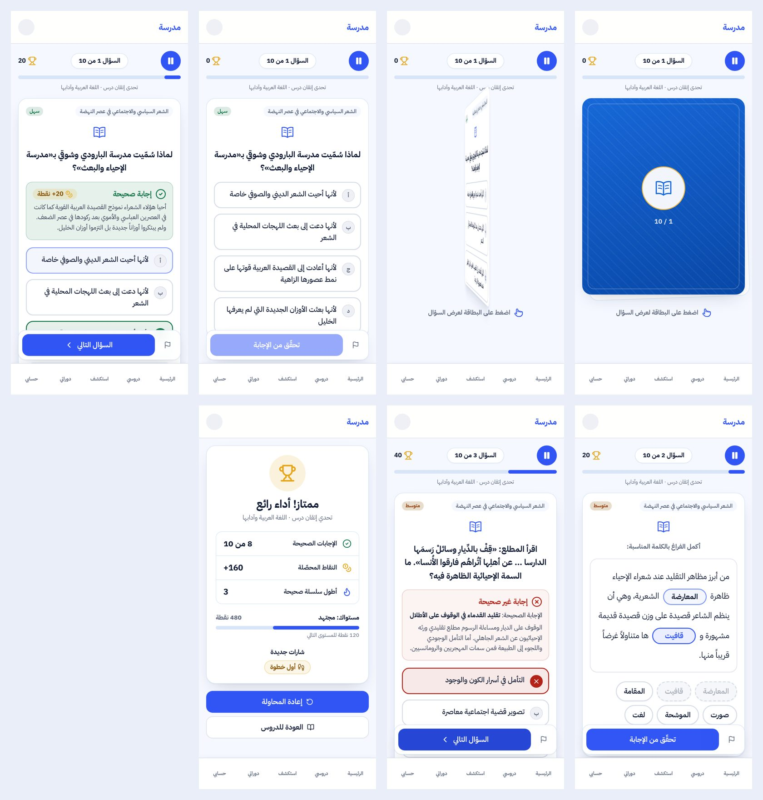

# لعبة البطاقات — المرحلة الأولى

تحويل جولة MADRASADZ PLAY الحالية إلى بطاقات تنقلب، دون لعبة ثانية ودون أي تغيير في الأسئلة أو التصحيح أو التسجيل أو الصلاحيات.
لم يُنشر شيء. المرجع البصري: حزمة `design-reference.png` و`design-tokens.json` التي أرفقها المالك.

## ما تغيّر للتلميذ

- المسار نفسه `/student/play/session/[id]`، والاختيار (السنة، الشعبة، المادة، الدرس) كما هو.
- **الشريط العلوي:** زر إيقاف، و«السؤال N من M»، ونقاط الجولة، وشريط تقدّم. المؤقت يظهر فقط في الوضع بالمؤقت الموجود أصلًا.
- **البطاقة المغلقة:** ظهر أزرق وتحته «اضغط على البطاقة لعرض السؤال».
  - تنقلب على محور Y خلال 600ms، وتكفي لمسة أو Enter أو Space.
  - مع `prefers-reduced-motion`، أو إن أطفأ التلميذ الحركة، يحدث التبديل فورًا.
- **وجه السؤال:** يعرض السؤال الحقيقي بنوعه، اختيارًا متعددًا أو ملء فراغ، والمطابقة والترتيب مدعومان أيضًا.
  - «تحقّق من الإجابة» لا يعمل حتى تكتمل الإجابة.
- **بعد الإرسال:** يظهر تصحيح معتدل اللون فوق الخيارات مع الشرح والنقاط، ثم «السؤال التالي».
- **النتيجة:** الإجابات الصحيحة، والنقاط، وأطول سلسلة صحيحة، والمستوى، والشارات الجديدة.
  - زر «إعادة المحاولة» يبدأ جولة جديدة بالتحدي نفسه عبر الإجراء الموجود.
  - زر «العودة للدروس».
- **انقطاع الإنترنت:** يظهر تنبيه ويتوقف الإرسال. إن ضاع الرد بعد التسجيل فلا يُحسب السؤال مرتين، لأن الخادم يرفض التكرار، وتُعرض النتيجة المحفوظة.

## الرجوع

- `?view=classic` في رابط الجولة يعرض الواجهة السابقة كما هي، فهي ملف `play-game.tsx` نفسه بلا تغيير وظيفي.
- الرجوع الكامل: `git revert` لهذا الفرع. لا ترحيل ولا بيانات.

## الملفات

| الملف | التغيير |
| --- | --- |
| `src/components/play/card-machine.ts` | جديد: حالات البطاقة (مغلقة ← تنقلب ← سؤال ← مُجابة ← التالية)، وقفل الإرسال المكرر، وفحص اكتمال الإجابة |
| `src/components/play/flip-card.tsx` | جديد: البطاقة، بـ CSS فقط، وARIA و`inert` للوجه المخفي |
| `src/components/play/play-card-game.tsx` | جديد: الجولة بالبطاقات، تستعمل `submitPlayAnswerAction` نفسه |
| `src/app/student/play/session/[id]/page.tsx` | البطاقات افتراضيًا، و`?view=classic` للقديمة |
| `src/app/student/play/session/[id]/loading.tsx` | جديد: هيكل البطاقة أثناء التحميل |
| `src/server/services/play.service.ts` | قراءة فقط: `getSessionView` يعيد `unitCode` لـ«إعادة المحاولة» |
| `src/components/play/question-cards.tsx` | خيار عرض عمود واحد للاختيار المتعدد داخل البطاقة؛ الافتراضي لم يتغيّر |
| `src/components/play/play-game.tsx` | تصدير `useBeep` فقط |
| `src/app/globals.css`, `tailwind.config.ts` | رموز `deck-*` داخل `.play-deck` فقط، وقواعد القلب |
| `vitest.config.ts` | JSX تلقائي لاختبار مكوّن `.tsx` |
| `tests/play-cards.test.ts` | جديد: 16 اختبارًا |

**دون تغيير:**
- قاعدة البيانات والترحيلات.
- `content/play` (5969 سؤالًا).
- منطق التصحيح والنقاط والإتقان والشارات.
- الأدوار والاشتراكات.
- `.env` و`android/`.

## التحقق

- **TypeScript:** نظيف.
- **ESLint:** نظيف على الملفات المعدّلة، والتحذيرات المتبقية سابقة وفي ملفات أخرى.
- **Vitest:** 106 ملفات و720 اختبارًا على المستودع كله، منها اختبارات اللعبة الحالية، ثم `play-cards` و`play` بعد آخر تعديل.
- **`next build`:** نجح («Compiled successfully»)، وحجم صفحة الجولة 16.3 kB.
- **معاينة Playwright محلية:**
  - المكوّن الحقيقي، وCSS المشروع، وأسئلة حقيقية من `content/play/3AS/AR/T067.json`.
  - إجراءات الخادم محاكاة بمفتاح الإجابة نفسه.
  - النتائج:
    - القلب مرة واحدة مع النقرات المتسارعة.
    - إرسال واحد مع النقر المزدوج.
    - التركيز ينتقل إلى السؤال ثم إلى البطاقة التالية.
    - Enter وSpace يعملان.
    - الحركة المخفّضة تبدّل فورًا.
    - لا تمرير أفقي في أي لحظة عند 390 و320.
    - لا أخطاء في وحدة التحكم.
- **لم يُختبر بعد:** على iPhone حقيقي، ولا على الموقع المنشور.

## للمرحلة الثانية (اقتراحات، لم تُنفّذ)

- تحديث شكل شاشات الاختيار (السنة، المادة، الدرس) بأسلوب المرجع.
- التلميح، وهو غير موجود في القواعد الحالية. يحتاج قرارًا: هل يخصم نقاطًا؟
- السلسلة اليومية والترتيب، ولوحة الصدارة معطّلة افتراضيًا لأن التلاميذ قُصّر.
- تكبير فراغات «ملء الفراغ» إلى 44px داخل السطر.
- اختبار على iPhone حقيقي داخل التطبيق وSafari، ثم قياس الأداء على جهاز ضعيف.
