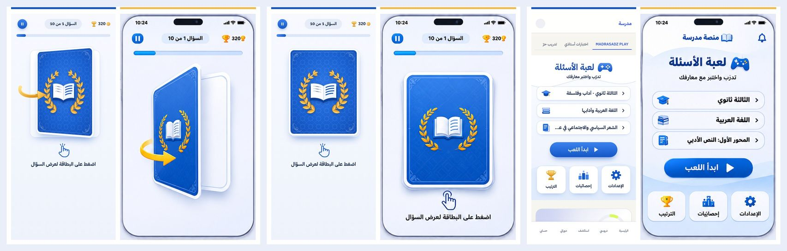
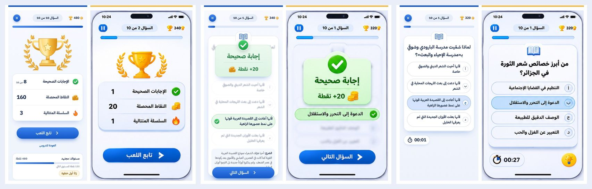
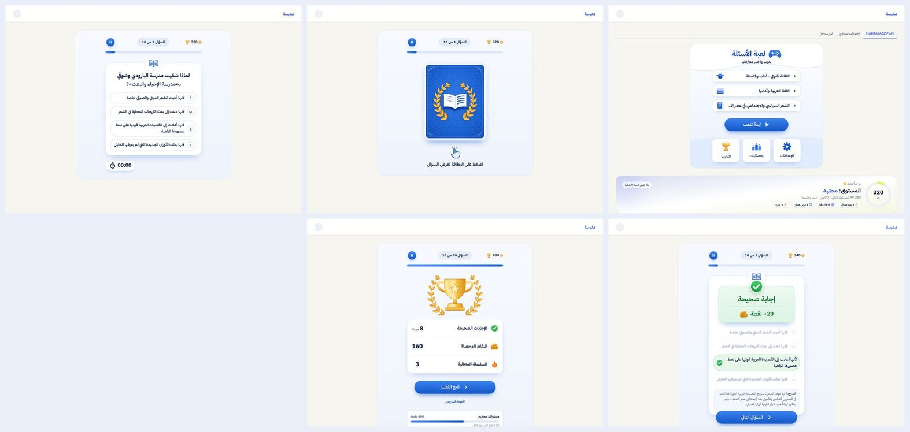

# لعبة الأسئلة بالبطاقات: الهوية البصرية المعتمدة

الواجهة الحالية للعبة MADRASADZ PLAY مطوّرة لتطابق حزمة الهوية `Madrasa_PLAY_Visual_Identity`، وهي مرجع ملزم من المالك:
- `00-APPROVED-REFERENCE.png`، والحالات من 01 إلى 06.
- الألوان من 07.

لم يُنشر شيء. لا تغيير على الأسئلة (5969 سؤالًا) ولا التصحيح ولا النقاط ولا الصلاحيات ولا قاعدة البيانات.

## الحالات كما نُفّذت (مكوّنات React حقيقية، لا صور)

| المرجع | التنفيذ |
| --- | --- |
| 01 الشاشة الأولى | `/student/play`: «لعبة الأسئلة»، ثم السنة والمادة والدرس من بيانات التلميذ الحقيقية، ثم «ابدأ اللعب»، ثم بلاطات الإعدادات والإحصائيات والترتيب. لوحة اللعبة السابقة كاملة تحتها. |
| 02 البطاقة المغلقة | بطاقة زرقاء بإطار أبيض ونسبة 4:5 فوق رزمة بيضاء، عليها زخرفة شبكية وزوايا وإكليل غار ذهبي وكتاب. كلها SVG مرسوم. تحتها يد اللمس و«اضغط على البطاقة لعرض السؤال». |
| 03 الدوران | البطاقة نفسها تدور 180° حول المحور Y (perspective وbackface-visibility) مع سهم ذهبي، فيظهر وجهها الأبيض. |
| 04 السؤال | تتسع البطاقة إلى بطاقة السؤال: لسان بأيقونة كتاب، ثم السؤال الحقيقي والاختيارات بالحروف أ ب ج د، ثم المؤقت. |
| 05 النتيجة | لوحة «إجابة صحيحة» أو «إجابة خاطئة» مع النقاط، والخيار الصحيح أخضر، والخاطئ المختار أحمر، والباقي باهت، ثم «السؤال التالي». |
| 06 النتيجة والتقدّم | الكأس والإكليل، ثم الإجابات الصحيحة والنقاط المحصلة والسلسلة المتتالية، ثم «تابع اللعب». |

**الألوان:**
- Primary `#1457C5`
- Accent `#8FAAFF`
- Background `#F5F8FF`
- Rewards `#F2B94B`
- Text `#172B50`
- Surface `#FFFFFF`

**ملاحظات على التنفيذ:**
- **الوضع الفاتح دائمًا:** اللعبة فاتحة حتى إن كان الموقع في الوضع الداكن، فلا تظهر الواجهة الكحلية.
- **شاشة كاملة على الهاتف واللوحي:** تختفي ترويسة الموقع وشريطه السفلي أثناء الجولة كما في المرجع، وتعودان عند الخروج. على الحاسوب تبقى الصفحة كما هي.
- **الشعار:** شعار الموقع الحقيقي في الترويسة، ولم يُستخرج شعار من الصور.

## ما تغيّر في السلوك (قرارات للمراجعة)

1. **الاختيار المتعدد:** لمس الخيار يختاره ويرسله مباشرة كما في المرجع، أي لا زر «تحقّق» قبل الإرسال. ملء الفراغ يبقى بزر «تحقّق من الإجابة» لأنه يحتاج أكثر من كلمة.
2. **المؤقت:**
   - في الوضع بالمؤقت يعرض الوقت المتبقي كما يحدده الخادم.
   - في غيره يعرض الوقت المنقضي على السؤال، للعرض فقط ودون أي أثر على النقاط.
3. **زر المصباح (التلميح) لم يُنفَّذ:** لا يوجد تلميح في القواعد الحالية.
   - كل سؤال له «هدف» مخزّن، لكنه يكشف الجواب أحيانًا، خاصة في ملء الفراغ.
   - إضافة التلميح تحتاج قرارًا من المالك: هل يخصم نقاطًا، ومن أين يأتي نصه؟
4. **«الترتيب»:** لا توجد لوحة ترتيب بين التلاميذ، فهي معطّلة افتراضيًا لأنهم قُصّر. البلاطة تنقل إلى المستوى والإنجازات في الصفحة نفسها. «الإحصائيات» تنقل إلى المواد والتقدّم.
5. **النقاط أعلى الشاشة:** مجموع نقاط التلميذ كما في المرجع (320 ثم 340). نقاط الجولة تظهر في شاشة النتيجة.
6. **وظائف أُبقيت خارج الصور:**
   - الشرح بعد كل إجابة.
   - الإبلاغ عن خطأ في السؤال، من زر الإيقاف.
   - الأصوات.
   - المستوى والشارات الجديدة وقائمة الأخطاء بعد النتيجة.
   - «أكمل من حيث توقفت».
   - `?view=classic` للواجهة السابقة.

## الملفات

| الملف | الدور |
| --- | --- |
| `src/components/play/play-art.tsx` | جديد: الرسوم المتجهة (ظهر البطاقة، الإكليل، الكتاب، السهم، الكأس، العملات، الشارات، أيقونات الشاشة الأولى) |
| `src/components/play/flip-card.tsx` | البطاقة: مغلقة، ثم تدور، ثم تتسع لبطاقة السؤال، مع ARIA و`inert`، والسؤال لا يُركَّب قبل الكشف |
| `src/components/play/deck-choices.tsx` | جديد: اختيارات 04 و05، والصحيح لا يظهر قبل رد الخادم |
| `src/components/play/play-card-game.tsx` | الجولة والشريط العلوي والنتيجة والإيقاف |
| `src/components/play/play-home.tsx` | جديد: الشاشة الأولى 01 |
| `src/components/play/immersive.tsx`, `deck-ui.ts` | جديد: شاشة كاملة على الهاتف، وزر المرجع |
| `src/components/play/card-machine.ts` | الحالات وقفل الإرسال وفحص اكتمال الإجابة |
| `src/app/student/play/page.tsx` | الشاشة الأولى فوق لوحة اللعبة، والمادة المختارة من `?subject=` |
| `src/app/student/play/session/[id]/page.tsx`, `loading.tsx` | البطاقات افتراضيًا، و`?view=classic` للسابقة |
| `src/server/services/play.service.ts` | قراءة فقط: `unitCode` في عرض الجلسة لـ«تابع اللعب» |
| `src/components/play/question-cards.tsx`, `play-game.tsx`, `dashboard.tsx` | تغييرات صغيرة: جملة ملء الفراغ بلا إطار داخل البطاقة، وتصدير `useBeep`، ومرساتان للبلاطات |
| `src/app/globals.css`, `tailwind.config.ts`, `vitest.config.ts` | ألوان الحزمة داخل `.play-deck`، وقواعد الدوران، وJSX في الاختبارات |
| `tests/play-cards.test.ts` | 20 اختبارًا |

## الرجوع

- **رجوع فوري:** `?view=classic` في رابط الجولة يعرض الواجهة السابقة كما هي.
- **رجوع كامل:** `git revert` لهذا الفرع، دون ترحيل ودون بيانات.

## التحقق

- **TypeScript وESLint:** نظيفان.
- **Vitest:** 106 ملفات و724 اختبارًا على المستودع كله، منها `play-cards` (20 اختبارًا).
- **`next build`:** نجح («Compiled successfully»). حجم `/student/play` 7.04 kB، وحجم الجولة 15.6 kB.
- **معاينة Playwright محلية:**
  - المكوّنات الحقيقية، وCSS المشروع، وأسئلة حقيقية من `content/play/3AS/AR/T067.json`.
  - إجراءات الخادم محاكاة بمفتاح الإجابة نفسه.
  - النتائج عند 390 و320 والحاسوب:
    - الدوران مرة واحدة مع النقرات المتسارعة.
    - إرسال واحد لكل لمسة.
    - التركيز ينتقل إلى السؤال ثم إلى البطاقة التالية.
    - Enter وSpace يعملان.
    - الحركة المخفّضة تبدّل فورًا.
    - لا تمرير أفقي ولا أخطاء في وحدة التحكم.
- **لم يُختبر:** على iPhone حقيقي، ولا على الموقع المنشور.

في كل زوج، المرجع يمين (شريط ذهبي) والتنفيذ يسار (شريط أزرق).
